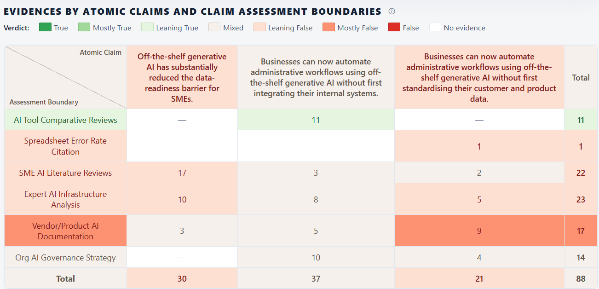

# FactHarbor

Open-source applications and web services for AI-powered fact-checking — every verdict backed by evidence you can inspect.

## Our Vision and Mission

**Our Vision**
A world where decisions and public debate are grounded in evidence so people can move forward with clarity and confidence.

**Our Mission**
The FactHarbor application brings clarity and transparency to a world full of unclear, contested, and misleading information by shedding light on the context, assumptions, and evidence behind claims.

**Non-profit. Open source.**

- **FactHarbor association (Verein):** The Swiss non-profit organization behind the work. It serves the public interest with transparency and no profit motive.
- **FactHarbor application:** The open-source fact-checking software developed within the association. Its sources, evidence and reasoning can be inspected.

## FactHarbor application’s next chapter

[**FactHarborDSS**](https://robertschaub.github.io/FactHarborDSS/) is the planned successor application, extending fact-checking to decision support.

## Read a FactHarbor report

[Open FactHarbor application](https://app.factharbor.ch/) to explore reports. FactHarbor is an Alpha; access to new analyses is by invitation.

[Learn how to interpret a FactHarbor report](product-development/specification/architecture/quality-and-trust/index.md).

In the presentation example below, the first entry in the reports list is labelled **Mixed**, with **Medium confidence**. It concerns generative AI and the preparation needed for small-business automation. These are the Alpha report's assessments, not independently validated conclusions or DSS output.

*Reports list captured 24 October 2026. Open the image for a larger view.*

### Inspect the evidence

The evidence matrix separates parts of the broader claim and groups evidence with compatible conditions—such as dates, locations and methods—into [assessment boundaries](product-development/specification/reference/terminology/index.md#core-concepts). Follow an item to its source and ask: Does it support the point? Does it apply here? What contradicts the conclusion, and what is missing?

*From the same example. Colours summarize the report's assessments; counts are evidence items, not votes or measures of evidence quality. Both screenshots are reproduced unchanged from the project presentation of 26 October 2026. Attribution: FactHarbor and its contributors.*

[Open the selected Alpha report](https://app.factharbor.ch/jobs/812e3d1c1c5d423ba27b4bb18dee2ff9). Availability and access depend on the application; these dated images illustrate the interface at that time.

## How it works

The application identifies factual claims, researches supporting and opposing evidence, and assesses the findings. A structured agent debate challenges the assessment before reconciliation and validation; model roles depend on the active configuration. Evidence-backed challenges can change a conclusion; agreement alone does not establish correctness.

[Full-size diagram](diagrams/homepage-method.svg) · [Analysis pipeline](akel-pipeline.md)

## Explore further

- [Understanding a FactHarbor report](product-development/specification/architecture/quality-and-trust/index.md) — interpreting evidence, verdicts and uncertainty.
- [Product development](product-development/index.md) — architecture, setup and contribution guidance.
- [Association and governance](organisation/index.md) · [About and contact](about-factharbor/index.md).
- [Cooperation](product-development/presentations/index.md) — research, newsroom and funding discussions.
- [Licence and disclaimer](license-and-disclaimer/index.md).
